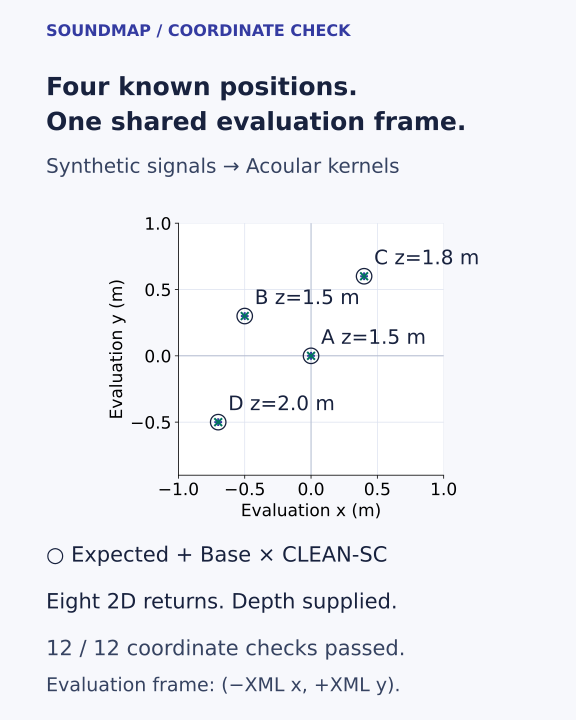

# SoundMap

**Microphone-array measurements into sound-source maps.**

SoundMap adds command dispatch, launcher failure reporting, verification documentation and a correction to the offline evaluation coordinate frame.

The application combines Acoular beamforming with a Bokeh dashboard and optional Flask camera overlay. Offline evaluation kernels use a shared x-mirrored coordinate frame, separate from the camera overlay frame.

## Try the offline coordinate check

No microphone, camera or trained model is needed for this path. It generates ideal 16-channel signals and runs the real Acoular evaluation kernels against known source positions.



*Generated signals, not a microphone-array capture. The plot shows the eight 2D returns from the [12-case coordinate check](docs/offline-coordinate-check.json). Its 2D and 3D kernels passed at their declared grid tolerances: 0.05 m for Base and 0.1 m for CLEAN-SC. Ideal, grid-aligned points do not establish real-world or sub-grid accuracy. The 2D calls receive the depth rather than estimating it.*

Use a separate Python 3.12 environment for the observed offline dependencies:

```bash
python3.12 -m venv .venv-kernels
source .venv-kernels/bin/activate
python -m pip install -r requirements-kernels.txt
python scripts/verify_localization.py \
  --work-dir .verification/localization \
  --output .verification/localization-result.json
```

The command writes generated HDF5 signals under `--work-dir`, prints each expected/returned coordinate pair, and saves a JSON receipt at `--output`. Exit 0 means all declared checks passed. The evaluation frame is **(−XML x, +XML y, +XML z)**; it is separate from the camera-overlay frame.

## Run the research dashboard

The full application targets Python 3.11 and uses `requirements.txt`, separately from the offline environment. Its current startup expects a configured microphone array **and an available model checkpoint**, even when the dashboard starts in Beamforming mode. Weights are not bundled. A missing checkpoint prevents the dashboard from opening.

```bash
python -m pip install -r requirements.txt
python soundmap.py --help
# Live application; requires configured hardware and model files:
python soundmap.py run --no-flask --model /absolute/path/to/model-directory
```

`--model` currently names a **directory**, not a `.keras` file. The application looks inside its `ckpt/best_ckpt/` subdirectory for `.keras` files whose names begin with an integer and a hyphen, then chooses the largest prefix. Without this option, it searches the hardcoded model directory in `acoustic-camera/models/`. The command runs from the application's required working directory, so use an absolute model-directory path.

The Bokeh dashboard opens at `http://localhost:5006/bokeh_app` with `--no-flask`. Omitting that flag also starts the Flask camera wrapper at `http://127.0.0.1:5000`; its video route opens camera index 0 when requested. `--no-flask` omits that wrapper; it does not remove the checkpoint requirement. Stop the launcher with **Ctrl+C**. [Launcher checks and execution limits](docs/VERIFICATION.md) distinguish process cleanup from actual application readiness.

For microphone geometry, device selection and the inherited model setup, see the [original setup guide](docs/REFERENCE.md). Live array acquisition, camera overlays and model inference have not been verified here.

## Processing layout


This remains a research/test application with the original implementation's limitations. A real microphone array, device configuration, optional camera, and any chosen model are needed for live use. No microphone, camera, or device-capture route was started during packaging.

## Verification

See [the verification record](docs/VERIFICATION.md) for dated checks and unavailable hardware/model checks. It distinguishes the original packaging parity check from the later synthetic evaluation-coordinate acceptance check.

## Source and license scope

Based on [rabeaifeanyi/acoustic-camera](https://github.com/rabeaifeanyi/acoustic-camera/tree/876dedd0a637ad95d6036c2009b354188241ae7e). Acoular-derived portions retain their separate BSD-3-Clause notices.

[Source and notices](THIRD_PARTY_NOTICES.md) identifies the original application and Acoular-derived file. [LICENSE](LICENSE) covers new and authorized contributions; it does not establish a grant for the remaining inherited application. The pinned original application has no project license file or README grant, and separate redistribution permission has not been verified.

Maintained by [nazeeh111](https://github.com/nazeeh111).
