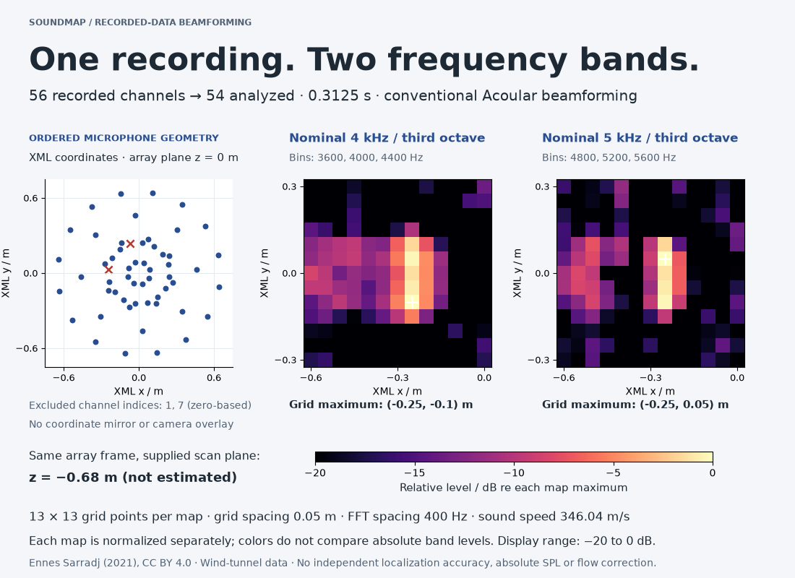
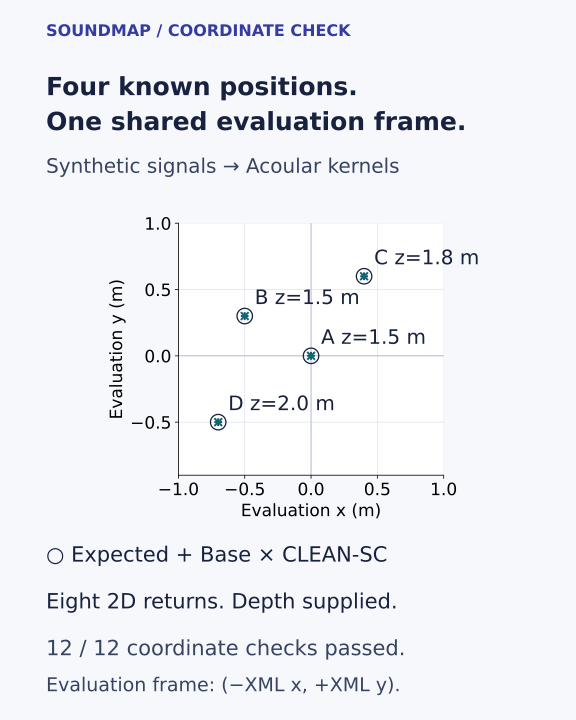
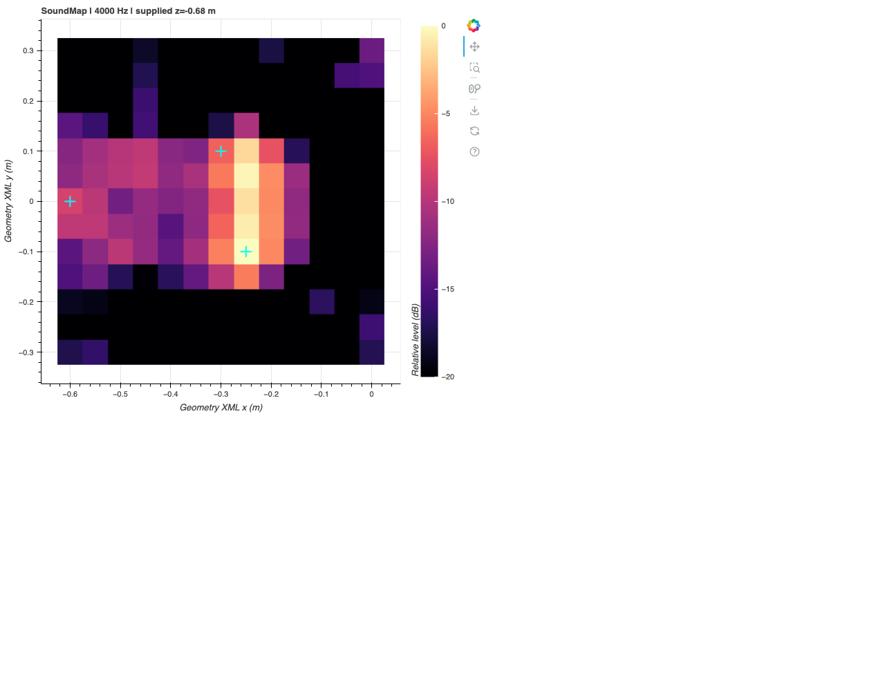
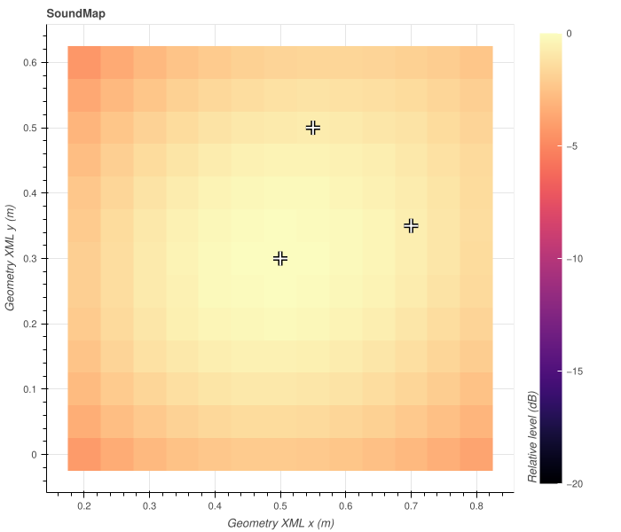
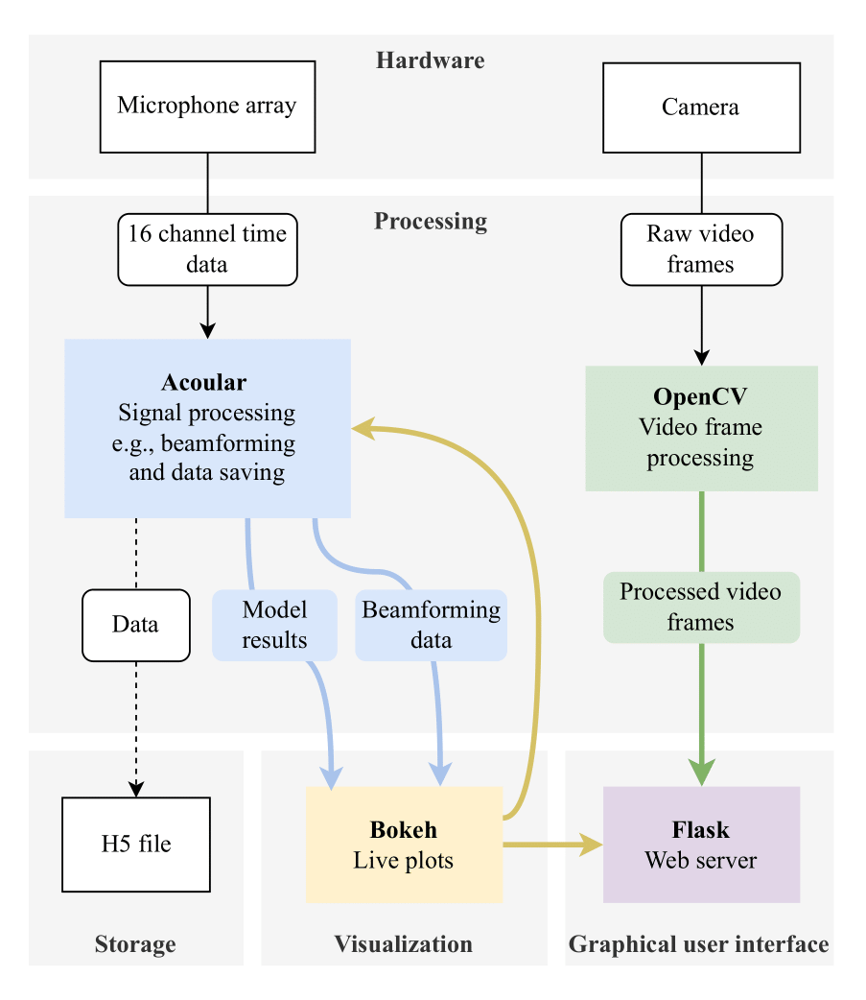

# SoundMap

**Microphone-array measurements into sound-source maps.**

The application combines Acoular beamforming with a Bokeh dashboard and optional Flask camera overlay. Recorded-data maps use the unmirrored geometry XML frame. The older evaluation kernels use an explicitly x-mirrored frame; both remain separate from camera overlay coordinates.

<picture>
  <source media="(max-width: 600px)" srcset="docs/presentation/recorded-bands-mobile.png">
  
</picture>

**One recorded input, two band-specific maps.** The public wind-tunnel example uses its matching geometry and channel factors, with channels `1` and `7` excluded. The same `0.3125 s` sample slice yields different map maxima at nominal `4 kHz` and `5 kHz`. Both maps use the unmirrored XML frame and a **supplied** `z = −0.68 m` plane. Colors show `10 log10(power / each map's maximum)`, clipped to −20…0 dB for display. They do not compare absolute levels between bands or establish independently measured source positions.

[Run these recorded-data maps](docs/presentation/README.md) · [Inputs, FFT bins and provenance](docs/presentation/provenance.json) · [Download and reopen the report exports](docs/presentation/report-exports.zip) · [Vector figure](docs/presentation/recorded-bands.svg)

Data: Ennes Sarradj (2021), [Microphone array data for basic examples in Acoular](https://doi.org/10.5281/zenodo.5809069), [CC BY 4.0](https://creativecommons.org/licenses/by/4.0/). Recording, geometry and channel factors are unchanged; the maps are derived outputs. [Actual interactive report capture](docs/presentation/report-current.png).

The published presentation bundle above records conventional `BeamformerBase` results produced with source commit `452eb6870a5601fa34d90bf81676015c185f5d82`. Its two bands were separate scalar calls. Its "current-main" label describes that producer snapshot; the original maps, reports, source hashes and attribution remain preserved. The optional methods and shared-input sweeps below are available in this source without changing the identity of those historical outputs. See [reproducing the preserved presentation](#reproduce-the-preserved-presentation) before re-rendering its figures.

## Try the offline coordinate check

No microphone, camera or trained model is needed for this path. It generates ideal 16-channel signals and runs the real Acoular evaluation kernels against known source positions.



*Generated signals, not a microphone-array capture. The plot shows the eight 2D returns from the [12-case coordinate check](docs/offline-coordinate-check.json). Its 2D and 3D kernels passed at their declared grid tolerances: 0.05 m for Base and 0.1 m for CLEAN-SC. Ideal, grid-aligned points do not establish real-world or sub-grid accuracy. The 2D calls receive the depth rather than estimating it.*

Use a separate Python 3.12 environment for the observed offline dependencies:

```bash
python3.12 -m venv .venv-kernels
source .venv-kernels/bin/activate
python -m pip install -r requirements-kernels.txt
python scripts/verify_localization.py \
  --work-dir .verification/localization \
  --output .verification/localization-result.json
```

The command writes generated HDF5 signals under `--work-dir`, prints each expected/returned coordinate pair in metres, and saves a JSON receipt at `--output`. Exit 0 means all declared checks passed at the stated grid tolerances, not that a real source was located. In the 2D checks the scan-plane depth is an input, not a recovered coordinate. The evaluation frame is **(−XML x, +XML y, +XML z)**; it is separate from the camera-overlay frame.

## Process a real recording offline

The unreleased source includes `soundmap-offline`, an installable recorded-data command.
From a source checkout, install the pinned dependencies from `requirements-offline.txt`,
then install the local package with `python -m pip install --no-deps .`.
Use `soundmap-offline --help` to see the inputs and options. The source launcher
`python soundmap.py offline` provides the same calculation. It computes peak coordinates, input hashes
and settings in JSON, a numerical NPZ map, and a self-contained interactive HTML plot. It needs no devices,
TensorFlow or model weights. The [recorded-data quickstart](docs/OFFLINE.md) uses
a small CC BY 4.0 wind-tunnel recording with matching geometry and calibration.

The default recorded-data method is **conventional Acoular `BeamformerBase`**. Add `--method clean-sc` for Acoular 25.3 CLEAN-SC deconvolution, or use `--frequencies 4000 5000` in place of `--frequency 4000` to compute a shared-input sweep. For example, after preparing the inputs described in the quickstart:

```sh
soundmap-offline \
  --input .verification/airfoil-data/example_data.h5 \
  --geometry .verification/airfoil-data/array_56.xml \
  --calibration .verification/airfoil-data/example_calib.xml \
  --invalid-channels 1 7 --start 0 --stop 16000 \
  --method clean-sc --frequencies 4000 5000 \
  --z=-0.68 --speed 346.04 --bounds -0.6 0 -0.3 0.3 \
  --increment 0.05 --block-size 128 --output clean-sc-sweep
```

A sweep captures the inputs once and shares its spectral computation across bands. It publishes `sweep.json` and complete per-band JSON, NPZ and offline HTML reports together into a new directory. Each report identifies its method, actual FFT bins, settings and supplied scan plane. Existing outputs are refused. The scalar command and output layout remain available. The [complete offline contract](docs/OFFLINE.md#frequency-sweeps-from-the-same-captured-inputs) explains admission limits and failure behavior.

CLEAN-SC uses the existing Acoular implementation; its component peaks are not a source-count guarantee. Close sources, reflections or incorrect geometry can remain unresolved. This source does not establish broad method superiority, physical localization accuracy, absolute SPL or recovered depth. The live dashboard's classical path remains its separate time-domain beamformer; the offline method flag applies to recorded-data maps.



*Newly computed from Ennes Sarradj’s CC BY 4.0 recording; [recipe and attribution](docs/OFFLINE.md). Cyan markers are separated map peaks, which may include sidelobes.*

The scan-plane depth is supplied; recorded-data execution does not establish
independent localization accuracy. The older ideal coordinate check above stays
separate from this measured-data path.

<details>
<summary>View a synthetic report export</summary>



This SVG was saved from the offline report for a generated 16-channel fixture. It is not a physical measurement. The strongest grid point was (0.5, 0.3, 1.5) m; the plane depth was supplied. [Report details](docs/OFFLINE.md#synthetic-report-preview).

</details>

## Run the research dashboard

Classical Beamforming is the default and needs **no neural checkpoint**. The
optional model selector is available only with an explicit compatible checkpoint.
Missing or malformed requested models fail with an actionable error.

```bash
python -m pip install -r requirements-classical.txt
# Read-only readiness: does not discover or start any audio/camera device.
python soundmap.py run --no-flask --no-device
# Live classical dashboard; press Start only with authorized configured UMA16:
python soundmap.py run --no-flask
# Optional neural mode: install requirements-neural.txt, then supply trained weights:
python soundmap.py run --no-flask --model /absolute/path/to/model-directory
```

`--model` names a directory containing `ckpt/best_ckpt/<integer>-*.keras`; the
largest integer prefix is selected. No weights are bundled, and neural inference
remains unvalidated. An unavailable UMA16 disables acquisition instead of silently
selecting the computer's default microphone.

Bokeh opens at `http://localhost:5006/bokeh_app` with `--no-flask`. For the optional
Flask wrapper install `requirements-camera.txt` and omit `--no-flask`. Its camera
feed is **disabled unless `--camera` is explicitly requested**; camera handles are
released on stream termination. Stop the launcher with **Ctrl+C**. For microphone
setup see [the setup guide](docs/REFERENCE.md). The dashboard reports **Stopping** until the current acquisition and cleanup return; results may be partial. A blocked native operation can leave it stopping indefinitely, and a cleanup error leaves restart unavailable. Closing a browser session requests the same stop. Another local dashboard session waits for the current acquisition to release ownership, and a new measurement waits for newly produced results before updating plots. Direct Python processor stop methods remain synchronous.

The save-time-data choice is fixed when a measurement starts. Stop waits for its allocated recording writer and removes the original splitter registrations before another measurement is admitted, including when configuration was changed programmatically. Live acquisition, camera registration and real neural inference remain separate unverified gates.

## Processing layout



This remains a research/test application with the original implementation's limitations. A real microphone array, device configuration, optional camera, and any chosen model are needed for live use. No microphone, camera, or device-capture route was started during packaging.

## Reproduce the preserved presentation

The [recorded presentation bundle](docs/presentation/README.md) is a historical artifact pinned to producer commit `452eb6870a5601fa34d90bf81676015c185f5d82`. Its NPZ maps and JSON receipts can be inspected without recomputing the recording; the included report archive can be extracted, hash-checked and opened offline. These published maps remain conventional results from two separate single-band calls.

`docs/presentation/render.py` checks the producing `evaluation/offline.py` and `scripts/offline_map.py` hashes before drawing from the stored arrays. Those implementation hashes changed when optional CLEAN-SC and shared sweeps were integrated, so running the preserved renderer directly against this source intentionally refuses the mismatch. Keep that check and its original provenance intact.

To re-render the same stored figures, use a disposable checkout of the recorded producer commit and copy the preserved `docs/presentation/` bundle from this source into its `docs/` directory. Run `python docs/presentation/render.py` there with NumPy and Matplotlib available. This verifies the recorded source hashes and renders the stored arrays without downloading the recording, calling a beamformer or accessing devices. For a new numerical run with current code, use the offline commands above and retain its new receipts separately; do not replace the historical source pins.

## Verification

See [the verification record](docs/VERIFICATION.md) for dated checks and unavailable hardware/model checks. It distinguishes the original packaging parity check from the later synthetic evaluation-coordinate acceptance check.

## Source and license scope

The adapted application is used with permission to use and rebrand without author credit. [LICENSE](LICENSE) covers first-party contributions. Separate Acoular BSD-3-Clause terms remain in [the retained component license](third_party/Acoular-LICENSE).

Maintained by [nazeeh111](https://github.com/nazeeh111).
