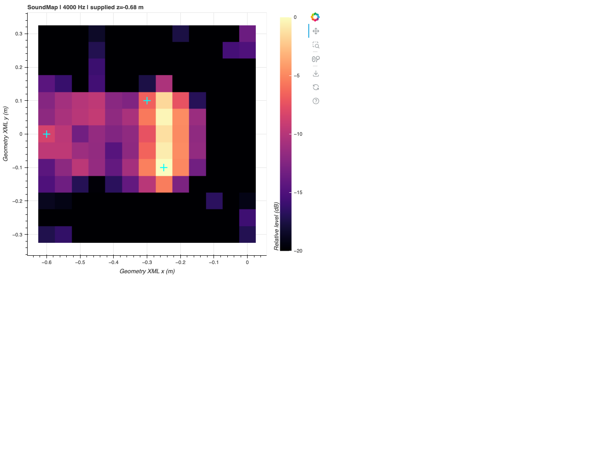

# SoundMap

**Microphone-array measurements into sound-source maps.**

The application combines Acoular beamforming with a Bokeh dashboard and optional Flask camera overlay. Offline evaluation kernels use a shared x-mirrored coordinate frame, separate from the camera overlay frame.

## Try the offline coordinate check

No microphone, camera or trained model is needed for this path. It generates ideal 16-channel signals and runs the real Acoular evaluation kernels against known source positions.


*Generated signals, not a microphone-array capture. The plot shows the eight 2D returns from the [12-case coordinate check](docs/offline-coordinate-check.json). Its 2D and 3D kernels passed at their declared grid tolerances: 0.05 m for Base and 0.1 m for CLEAN-SC. Ideal, grid-aligned points do not establish real-world or sub-grid accuracy. The 2D calls receive the depth rather than estimating it.*

Use a separate Python 3.12 environment for the observed offline dependencies:

```bash
python3.12 -m venv .venv-kernels
source .venv-kernels/bin/activate
python -m pip install -r requirements-kernels.txt
python scripts/verify_localization.py \
  --work-dir .verification/localization \
  --output .verification/localization-result.json
```

The command writes generated HDF5 signals under `--work-dir`, prints each expected/returned coordinate pair, and saves a JSON receipt at `--output`. Exit 0 means all declared checks passed. The evaluation frame is **(−XML x, +XML y, +XML z)**; it is separate from the camera-overlay frame.

## Process a real recording offline

`python soundmap.py offline` computes a source map, peak coordinates, input hashes
and settings in JSON, a numerical NPZ map, and a self-contained interactive HTML plot. It needs no devices,
TensorFlow or model weights. The [recorded-data quickstart](docs/OFFLINE.md) uses
a small CC BY 4.0 wind-tunnel recording with matching geometry and calibration.



*Newly computed from Ennes Sarradj’s CC BY 4.0 recording; [recipe and attribution](docs/OFFLINE.md). Cyan markers are separated map peaks, which may include sidelobes.*

The scan-plane depth is supplied; recorded-data execution does not establish
independent localization accuracy. The older ideal coordinate check above stays
separate from this measured-data path.

## Run the research dashboard

Classical Beamforming is the default and needs **no neural checkpoint**. The
optional model selector is available only with an explicit compatible checkpoint.
Missing or malformed requested models fail with an actionable error.

```bash
python -m pip install -r requirements-classical.txt
# Read-only readiness: does not discover or start any audio/camera device.
python soundmap.py run --no-flask --no-device
# Live classical dashboard; press Start only with authorized configured UMA16:
python soundmap.py run --no-flask
# Optional neural mode: install requirements-neural.txt, then supply trained weights:
python soundmap.py run --no-flask --model /absolute/path/to/model-directory
```

`--model` names a directory containing `ckpt/best_ckpt/<integer>-*.keras`; the
largest integer prefix is selected. No weights are bundled, and neural inference
remains unvalidated. An unavailable UMA16 disables acquisition instead of silently
selecting the computer's default microphone.

Bokeh opens at `http://localhost:5006/bokeh_app` with `--no-flask`. For the optional
Flask wrapper install `requirements-camera.txt` and omit `--no-flask`. Its camera
feed is **disabled unless `--camera` is explicitly requested**; camera handles are
released on stream termination. Stop the launcher with **Ctrl+C**. For microphone
setup see [the setup guide](docs/REFERENCE.md). Live acquisition, camera registration
and real neural inference remain separate unverified gates.

## Processing layout


This remains a research/test application with the original implementation's limitations. A real microphone array, device configuration, optional camera, and any chosen model are needed for live use. No microphone, camera, or device-capture route was started during packaging.

## Verification

See [the verification record](docs/VERIFICATION.md) for dated checks and unavailable hardware/model checks. It distinguishes the original packaging parity check from the later synthetic evaluation-coordinate acceptance check.

## Source and license scope

The adapted application is used with permission to use and rebrand without author credit. [LICENSE](LICENSE) covers first-party contributions. Separate Acoular BSD-3-Clause terms remain in [third-party notices](THIRD_PARTY_NOTICES.md).

Maintained by [nazeeh111](https://github.com/nazeeh111).
